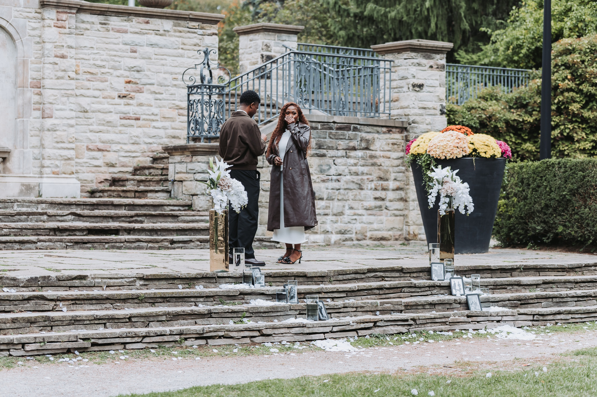
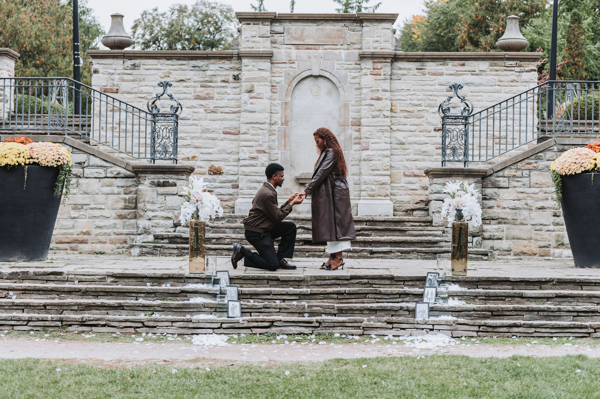
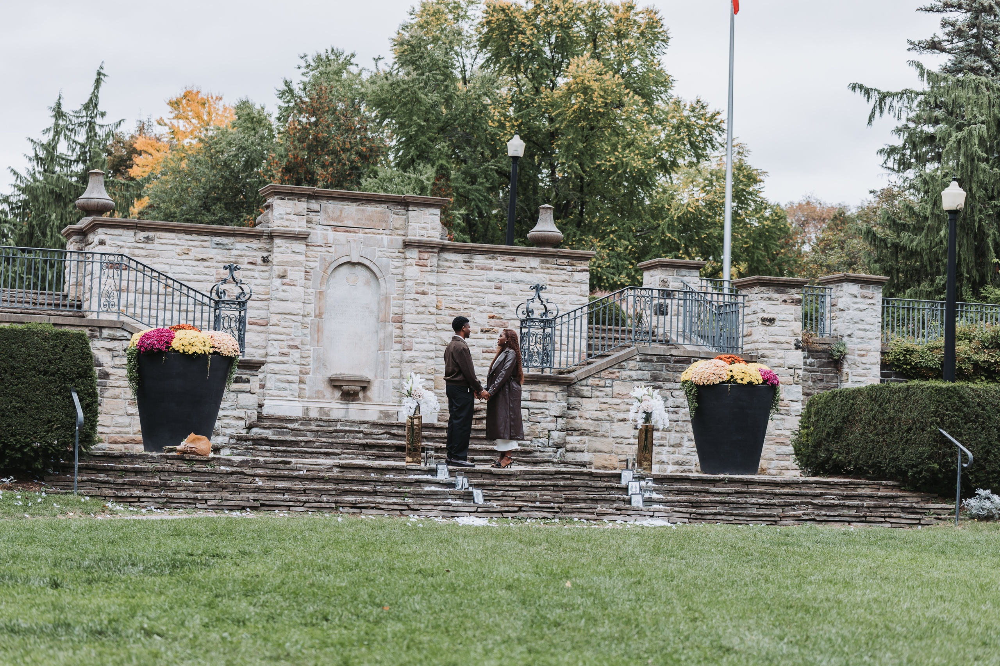
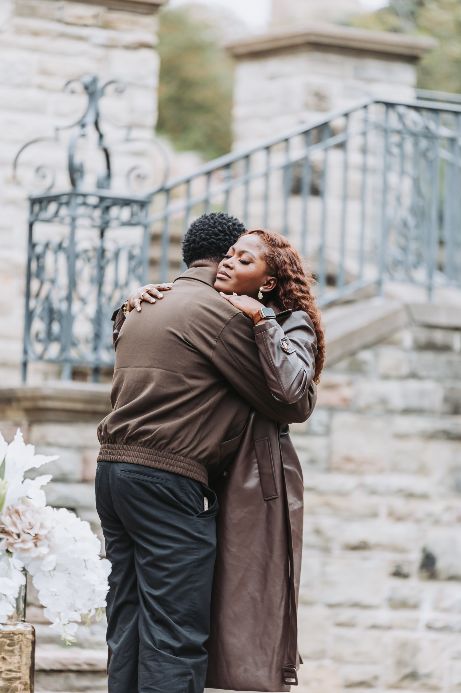
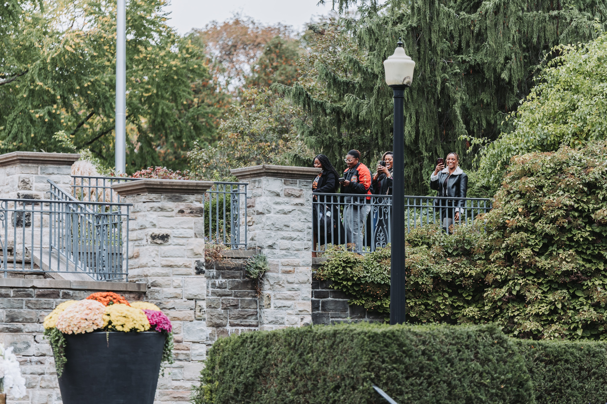
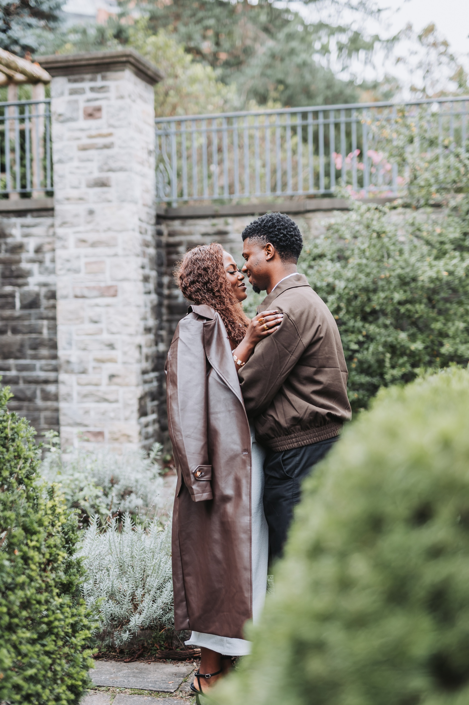
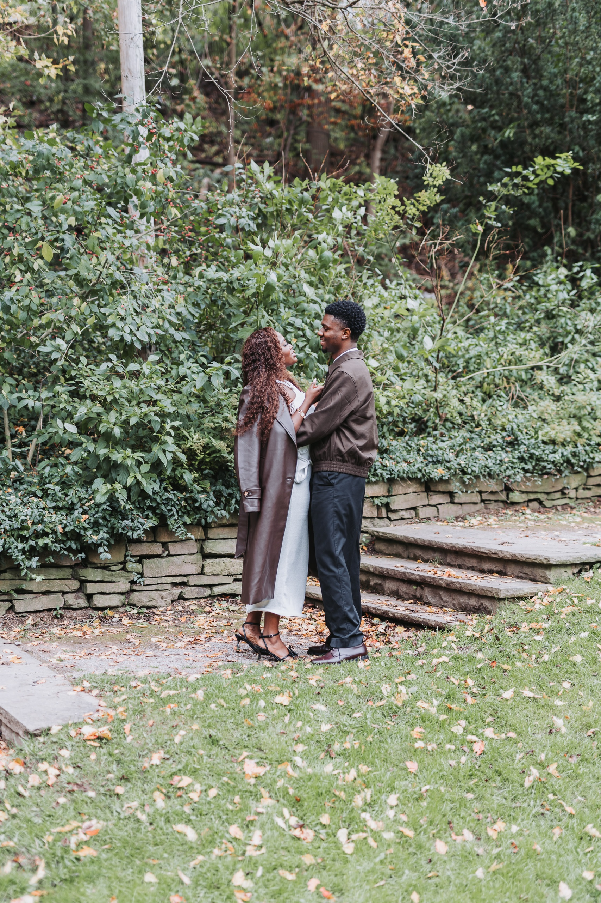
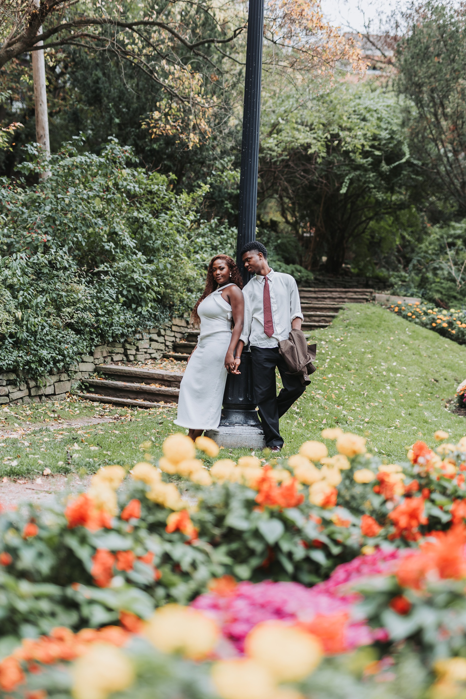
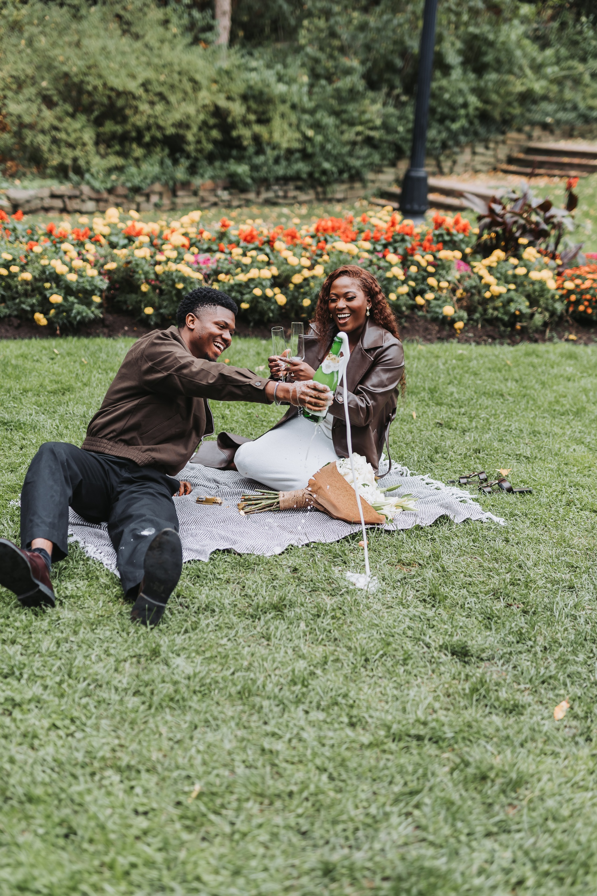
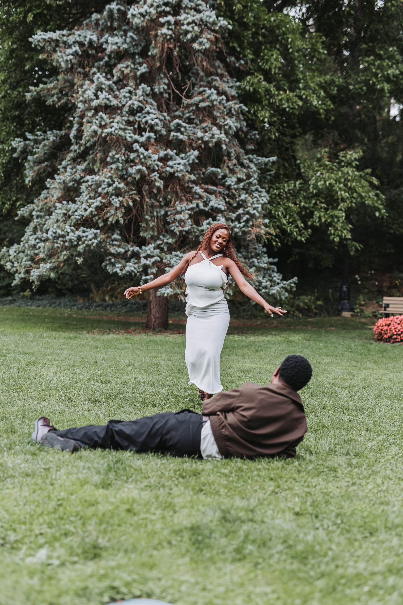

Aimee saw the framed photos on the steps before she saw anything else. Then the white lilies, then Richie, and then both of her hands went over her mouth. I was standing far back across the lawn with a long lens.

That was a grey Wednesday afternoon in October at Alexander Muir Memorial Gardens, a formal sunken garden tucked off Yonge Street in North Toronto. It is one of the best proposal spots in the city that most people drive past without noticing.

This guide covers the garden, the corners I use, permits, parking and timing, with Richie and Aimee's proposal as the example.

## Alexander Muir Memorial Gardens at a glance

**Location:** 2901 Yonge Street, on the east side of Yonge just south of Lawrence Avenue, in Lawrence Park.

**What it is:** A formal garden built in 1933 for Alexander Muir, who wrote The Maple Leaf Forever. It first stood across from Mount Pleasant Cemetery. In 1951 the Yonge subway needed that land, so the walls and plantings were moved up Yonge Street, and the garden was dedicated again on its new site in 1952.

**Setting:** Terraced lawns, a stone terrace with an arched niche and twin iron stair railings, clipped hedges, crushed brick paths, long flower beds, and an ivy covered stone wall in the lower garden. The ravine trails start at the bottom.

**Getting there:** Lawrence subway station is a short walk north. There is no lot at the Yonge Street gate.

**Permits:** Not needed for a small proposal. A bigger wedding day group may need a City of Toronto booking.

**Best seasons:** Spring through fall.

## Why the terrace works for a proposal

The garden steps down from Yonge Street in levels. At the bottom, a stone terrace faces an open lawn. The wall has an arched niche in the middle and an iron stair railing curving up on each side. It is symmetrical, so anyone standing in the centre of those steps looks framed.

The lawn solves the photographer problem. I can stand well back, shoot straight up the steps, and look like anyone else enjoying the park. The steps are wide enough to dress with flowers and photos without blocking anything.

For Richie and Aimee the steps were set with white lilies in gold vases, glass candle holders and a line of framed photos of the two of them, with petals down the stairs.

## The best corners after the yes

### 1. The terrace steps

This is the stage for the proposal and the first hugs. Stay here for ten minutes after the yes. The emotion is still fresh and the backdrop is already set.

### 2. The upper terrace railing

Family can watch from the terrace above, behind the iron railing, without being in the way. Richie and Aimee's family stood up there with their phones out, and it made one of my favourite frames of the day.

### 3. The hedged corners

Short flagstone stairs run between pairs of rounded clipped hedges. Shoot past the hedge and the couple sits in a pocket of soft green. This is where I do close portraits.

### 4. The ivy covered wall

Lower down there is an old stone retaining wall covered in ivy, with worn stone steps in front. In October the leaves were already down here. It feels older and wilder than the formal terrace.

### 5. The open lawn and flower beds

The lawn is big enough to run across. In October the beds along it were full of mums and marigolds. I shot the run with a slow shutter, so the flowers streaked behind them.

Shoot over the flower beds with the couple further back and the colour fills the bottom of the frame.

## How the hidden proposal worked

**We picked the exact step in advance.** Not just "the garden", but the centre of the terrace steps, facing the lawn.

**The setup went on the steps.** Lilies, candle holders, framed photos and petals, all ready before they walked in.

**They walked in together.** Richie and Aimee came down the gravel path between the flower beds, hand in hand. She had no idea until she reached the steps.

**I stayed back.** From across the lawn I photographed the walk in, the moment she saw the photos, the knee and the first hug, without interrupting any of it.

**Then the family and the portraits.** A few group photos on the steps, then the rest of the hour walking the garden. We finished with champagne on a blanket on the lawn.

The full set is in the [Richie and Aimee gallery](/portfolio/richie-aimee/).

## Permits, in plain words

**A small proposal needs no permit.** A couple, one photographer and a few family members is normal use of a public park.

**A bigger wedding group may need one.** The City of Toronto lists this park for wedding photography: a two hour minimum, up to 30 people, booked through Park Bookings. If you are planning wedding day photos here with a full wedding party, call Park Bookings at 416-396-7378 first. My [guide to booking a Toronto park photo permit](/blog/toronto-park-photo-permit-how-to-book/) walks through every step.

## When to go

**Weekday afternoons** are quiet. Richie and Aimee's proposal was on a Wednesday at two in the afternoon.

**Overcast days** are a gift here. The pale stone and the white flowers stay soft instead of glaring.

**Mid October** gave us mums and marigolds in the beds, the first orange in the trees and fallen leaves by the ivy wall. Summer brings roses and full green. Winter leaves the beds bare.

## Who this garden is right for

**You want formal and classic.** Stone, iron railings, symmetry and clipped hedges. It reads like an old estate garden, right on Yonge Street.

**You are bringing family.** The upper terrace gives them a place to watch without being in the frame.

**You want variety in one hour.** Terrace, hedges, ivy wall and open lawn are all within a few minutes' walk.

If you are still choosing, the [Toronto Music Garden proposal guide](/blog/toronto-music-garden-proposal-photography/) covers a downtown option with the CN Tower in the frame.

## Photograph your proposal at Alexander Muir Memorial Gardens

If you are planning to propose here and want a photographer who knows where to hide and which step to stand on, tell me the plan.

[**View the proposal package →**](/services/proposal/)

Or [send a note about Alexander Muir Memorial Gardens](/contact?venue=alexander-muir-gardens) with the date you have in mind.

Quick reference: the [Alexander Muir Memorial Gardens location guide](/location-guide/alexander-muir-gardens/) has the parking, permit and walking notes on one page.
