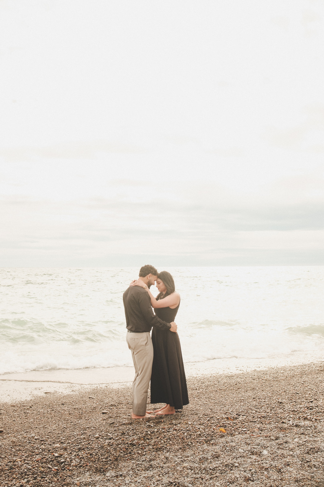
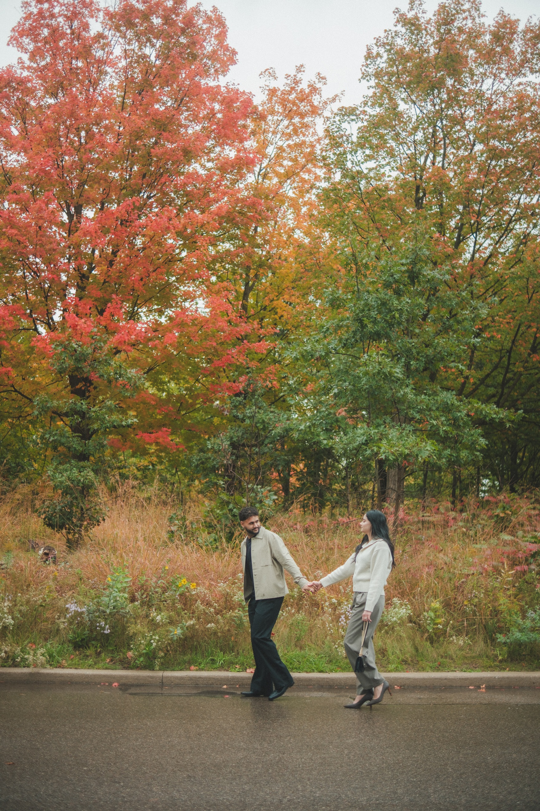
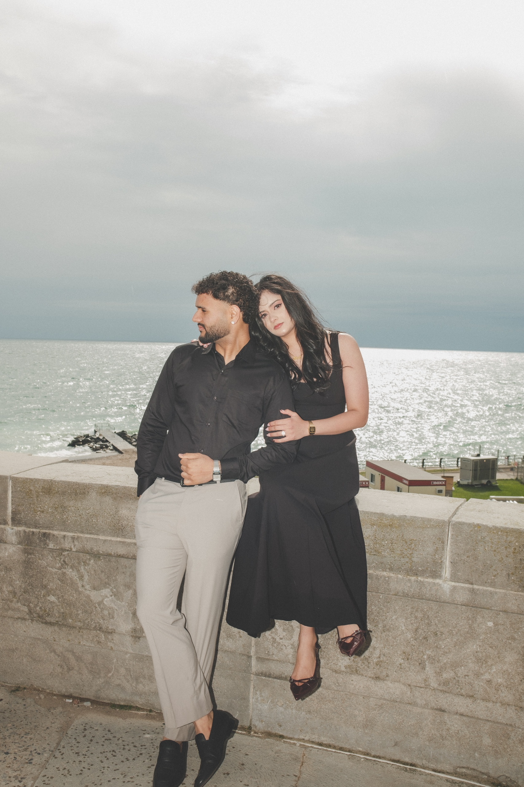
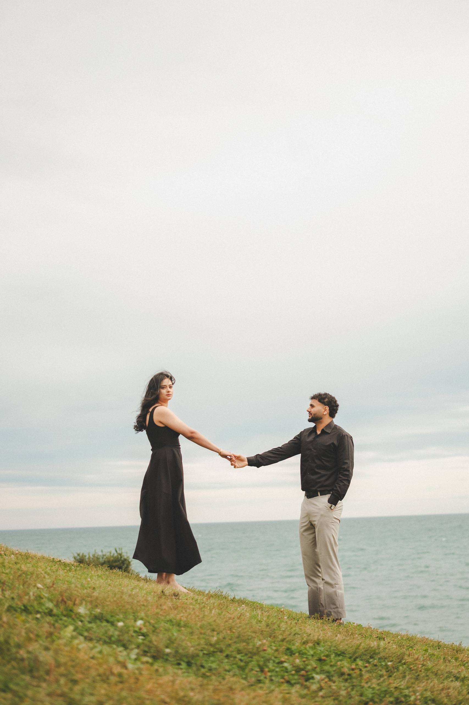
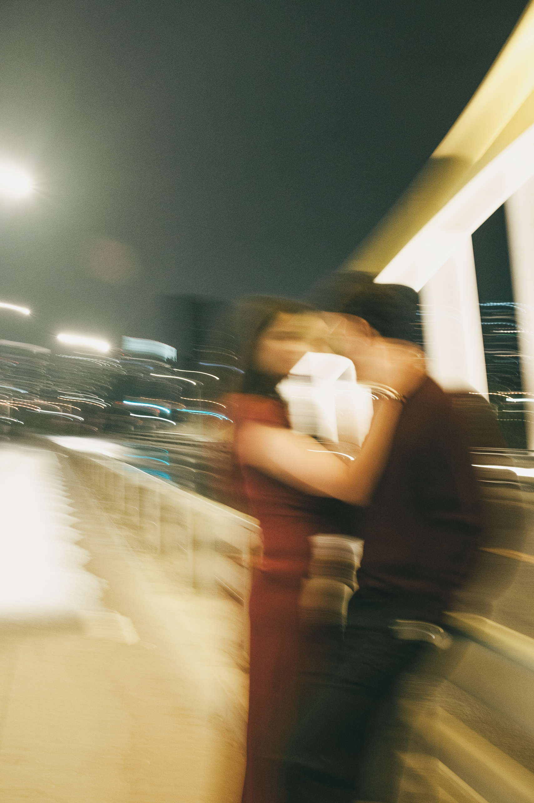
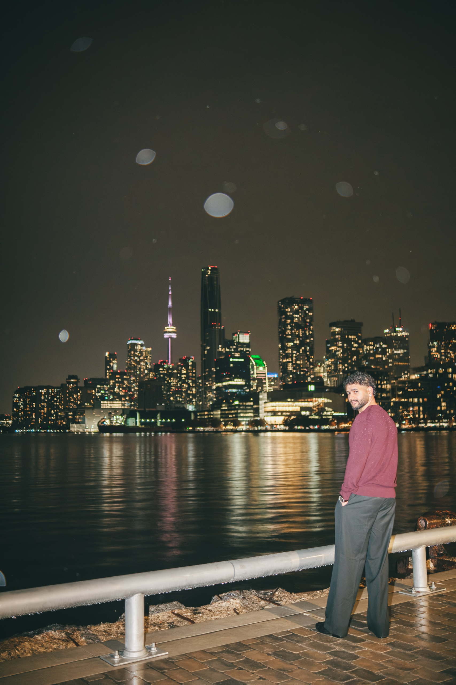
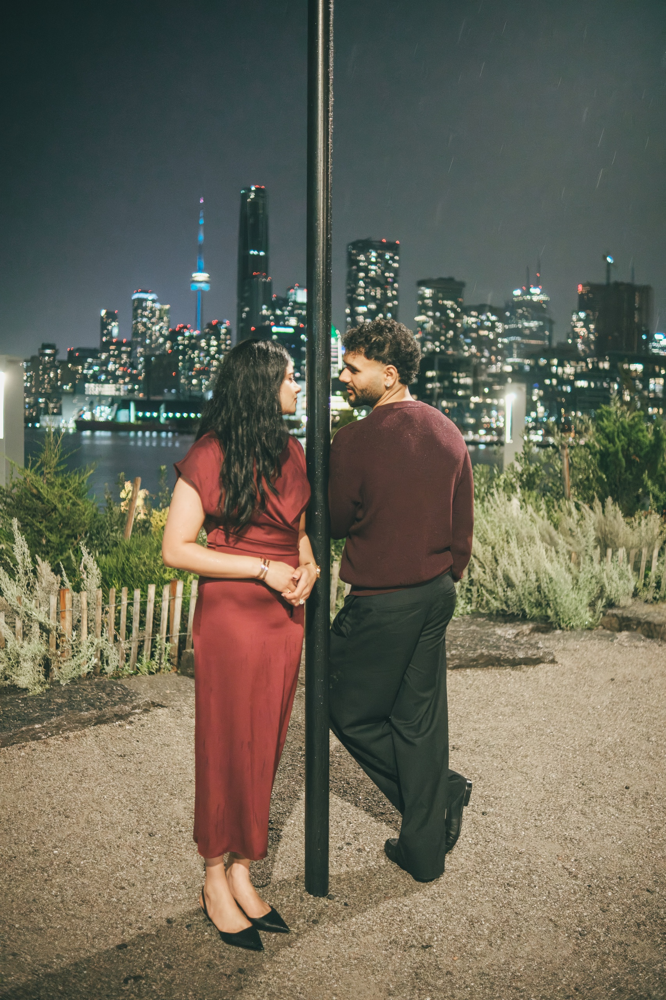
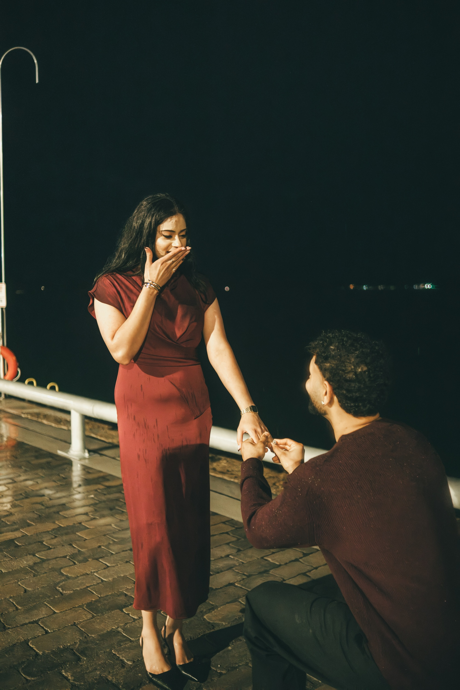

On Sunday, October 11, 2026, the Thanksgiving long weekend, I spent the whole day with Harnoor and Harsh, and the sun never came out. It was grey from my first frame at RC Harris, just before 9:30 in the morning. The roads in High Park were wet by the afternoon. By the time we reached the skyline at Biidaasige Park that night, light rain was falling. If you are reading about rainy day engagement photos because your own forecast looks like that, this post is for you.

The grey day gave us three different looks: a pale, windy lakefront in the morning, soft fall colour in the afternoon, and wet city lights at night. Every frame is in [Harnoor and Harsh's gallery](/portfolio/harnoor-harsh/), and the film from the same day is on that page too.

## Rainy day engagement photos at a glance

**Light rain:** We shoot, as long as you said yes to light rain in your shoot brief.

**Heavy rain or storms:** I can call a weather move for heavy rain, storms, extreme cold or heat, poor air quality or unsafe conditions. It costs you nothing.

**When I decide:** By 6 PM the day before, or on the morning of the shoot. Every booking names a backup date for weather.

**What cloud does to light:** A full cloud layer turns the sky into one big soft light, so nobody squints and skin stays even at any hour.

**What to bring:** A clear umbrella, flat shoes for walking, and a towel and dry socks in the car.

**Best wet weather spots:** Under cover, the Knox College cloister at U of T, or Union Station with a permit. In the open, waterfront like RC Harris under a heavy sky.

## The day the sun never came out

**RC Harris, 9:29 AM to 12:12 PM.** Full cloud. A flat grey white sky over a pale grey green lake with real chop on it. No rain fell here. The wet concrete at the water's edge was lake spray, and the wind kept lifting Harnoor's hair. Both wore black on top: her long sleeveless dress with a square neckline, his button shirt over light stone trousers. They took their shoes off for the pebble beach. Back on the lawn, Harnoor was still barefoot with her heels in her hand, and Harsh's trouser hems were wet.

**High Park, 2:03 PM to 3:52 PM.** Still overcast, still soft. I did not see rain falling while we shot, but the park road under the big red maple was wet and some paths looked damp. They had changed into soft neutrals. She wore a cream knit cardigan top with taupe wide leg trousers. He wore a sand beige overshirt over a black t shirt and black trousers.

**Biidaasige Park, 7:10 PM to 8:22 PM.** Sunset was about 6:40 PM, so this whole stop was after dark. We started on the yellow arched bridge at the edge of the park, where the road and the sidewalk were wet and shining. Then we walked to the harbour edge promenade, with the downtown skyline and the CN Tower across the water. That is where the light rain shows up in the frames. Harnoor wore a deep red satin midi dress. Harsh wore a dark burgundy knit sweater with black trousers.

Not one frame that day has sunshine in it.

## Why cloudy light is good for portraits

In a grey week, couples often ask me if cloudy days are good for photos. For portraits of two people, yes.

The sun is a small, very bright light, and small lights make hard shadows with sharp edges under the eyes and chin. A full layer of cloud spreads that light across the whole sky, so the sky becomes one huge, soft light. Shadow edges go soft, nobody squints, and skin looks even. Because the light comes from everywhere, I can face a couple in any direction at any hour.

RC Harris shows it well. Around midday on a clear day, that pale limestone and hard sun are a tough pair. The stone throws glare back at you, and faces go dark under the brows. On October 11 that problem never came up, and I could face them whichever way the frame wanted.

Colour holds up too. Without glare, leaves, grass and clothes keep their real colour. Wet surfaces go darker and richer. In High Park the red maple stayed a deep red, and the wet road under it went dark and glossy.

Now the honest part. Cloud takes some things away.

**No golden hour.** On a fully grey day there is no warm, low glow at the end of the afternoon. If that gold light is the one thing you want, cloud will not give it to you.

**A flat white sky.** Show too much of it and it reads as blank. So I either frame less sky, or I use it on purpose as empty space, like the wide frames on the hill at RC Harris where the two of them stand small under all that white.

**Less light late in the day.** Heavy cloud makes the afternoon go dim sooner. I plan the day so the open, bright places come first.

That is the real trade with cloudy day engagement photos. You give up the glow, and you get even, easy light for the whole day. Overcast engagement photos look quieter than sunny ones, softer in the shadows and calmer in the colour.

## What rain adds

**Wet ground turns into a mirror.** On the bridge, the wet road and sidewalk picked up every street light. In one frame I dragged the camera as they kissed, so the bridge lights and car trails smear across them.

**Raindrops light up.** At the harbour edge, the flash lit raindrops in the air and turned them into pale round spots against the black sky, with the CN Tower behind Harsh. In another frame by the water, you can see thin streaks of rain against the sky behind them both.

**Places empty out.** Most people head home when it rains. In the bridge frame at the top of this post, the sidewalk behind them is empty.

**Couples stand closer.** Rain pulls two people in. On the bridge she held his face and their faces almost touched. At the harbour edge, Harsh went down on one knee again on the wet pavers and took her hand.

Engagement photos in the rain work in light rain. Heavy rain is a different story.

## When I shoot and when I move the date

When a couple asks me what happens if it rains on their engagement shoot, this is the answer, the same plan that is in my client agreement.

**Light rain:** it does not stop the shoot, if you told me in your shoot brief that you are happy to shoot in it.

**Heavy rain, storms, extreme cold or heat, poor air quality, or anything unsafe:** I can call a weather move. A weather move costs you nothing.

**When I call it:** by 6 PM the day before, or on the morning of the shoot. Every booking already names a backup date for weather, so we are not starting from zero.

**If the weather turns while we are out:** we move under cover, we wait it out, or we stop and finish your remaining time on another date, at no cost.

The short version: if it rains, I still shoot, in covered spots, indoor spaces, or your home.

## What to bring when the forecast is grey or wet

**A clear umbrella.** Light passes straight through it, so your faces stay lit underneath. On an October evening in 2025, Manisha and Harish stood under a clear umbrella strung with fairy lights, and you can see their faces through it. That frame is in [Manisha and Harish's gallery](/portfolio/manisha-harish/).

**Flat shoes for walking.** Wear them between spots and change for the frame. At RC Harris, both went barefoot on the pebble beach. Harnoor stayed barefoot on the lawn with her heels in her hand, and Harsh's trouser hems got wet.

**A towel and a spare pair of socks in the car.** For the drive to the next spot.

**Layers you can drop for a frame.** On between shots, off for the photo.

**Hair that can handle wind and damp.** Grey days by the lake are often windy, as Harnoor's hair at RC Harris shows.

## Where to shoot in Toronto when it is wet

Permit rules for these and many more are in my [Toronto photo permits table](/toronto-photo-permits/).

### The Knox College cloister, University of Toronto

A covered stone arcade wrapped around a lawn, so the light stays soft and even and you stay dry. No permit is needed for engagement or pre-wedding photos at U of T, including the Knox College cloister. Weekend parking is about $10. See the [University of Toronto location guide](/location-guide/uoft/).

### Union Station Great Hall

A huge indoor hall with warm stone and tall arched windows. Professional photography there needs a permit requested by email at least two weeks ahead, so book it early. See the [Union Station location guide](/location-guide/union-station/).

### Allan Gardens Conservatory

Palms under Victorian glass, warm and dry whatever the weather is doing outside. The outdoor grounds are free, but the indoor conservatory needs a City of Toronto commercial photography permit. See the [Allan Gardens location guide](/location-guide/allan-gardens/).

### The Financial District

Not covered, but wet pavement there reflects the towers. TD Centre needs no permit. My [winter engagement photos post](/blog/winter-engagement-photos-toronto/) shows the block on a cold day, and the [TD Centre guide](/location-guide/td-centre/) has details.

### Open waterfront: RC Harris and the Port Lands harbour edge

These look their best under a heavy sky, and at night after rain. [RC Harris](/location-guide/rc-harris/) needs no permit for photography, and street parking is free until 4 PM. My [RC Harris engagement photos guide](/blog/rc-harris-engagement-photos-toronto/) covers the whole site. The harbour edge at Biidaasige Park is where Harnoor and Harsh finished in the rain.

## What about fall, and what about outfits

This was a fall day too. High Park had red and orange maples on October 11, with many trees still green. If timing the leaves is your worry, read my [fall engagement photos guide](/blog/fall-engagement-photos-toronto/). If you want to know why black, then neutrals, then deep red held up on a grey day, read my post on [what colours to wear for engagement photos](/blog/what-colours-to-wear-engagement-photos/).

## What it costs

A grey or wet day costs the same as a sunny one. My pre-wedding sessions start at $351.25 for the Love Story Mini, up to 2 hours at one location. Two locations and two outfits fit the Love Story Duo at $551.25 for up to 3 hours, or a longer session if you want more looks. If I call a weather move, it costs you nothing. Every package is on my [pre-wedding page](/services/pre-wedding/).

## Book, rain or shine

If your date is close and the forecast keeps changing, send it to me anyway. I watch the forecast with you, and your backup date is written in from the start. Tell me your date and roughly where you would like to be on my [contact page](/contact/).

[**See pre-wedding packages →**](/services/pre-wedding/)
