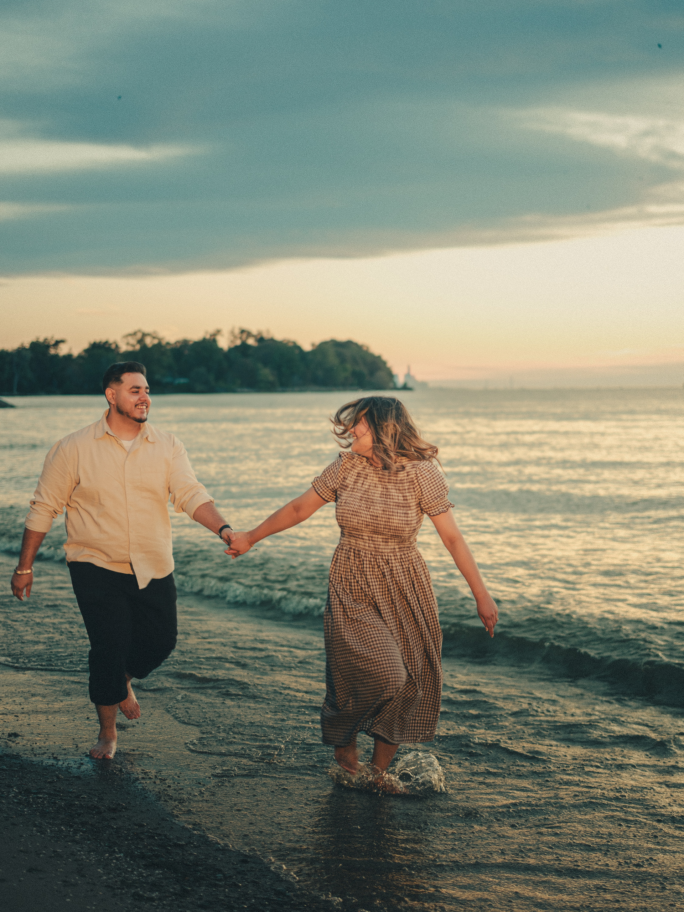
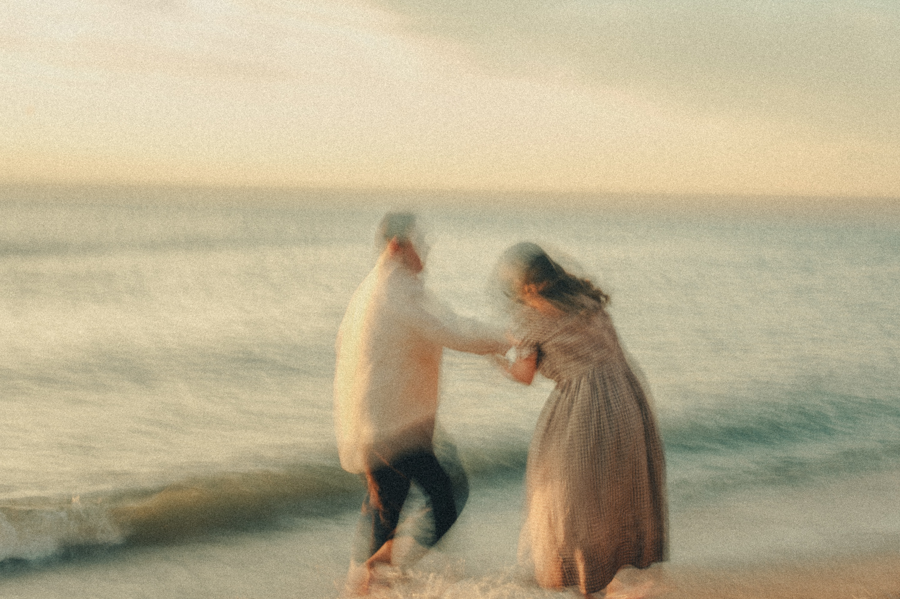
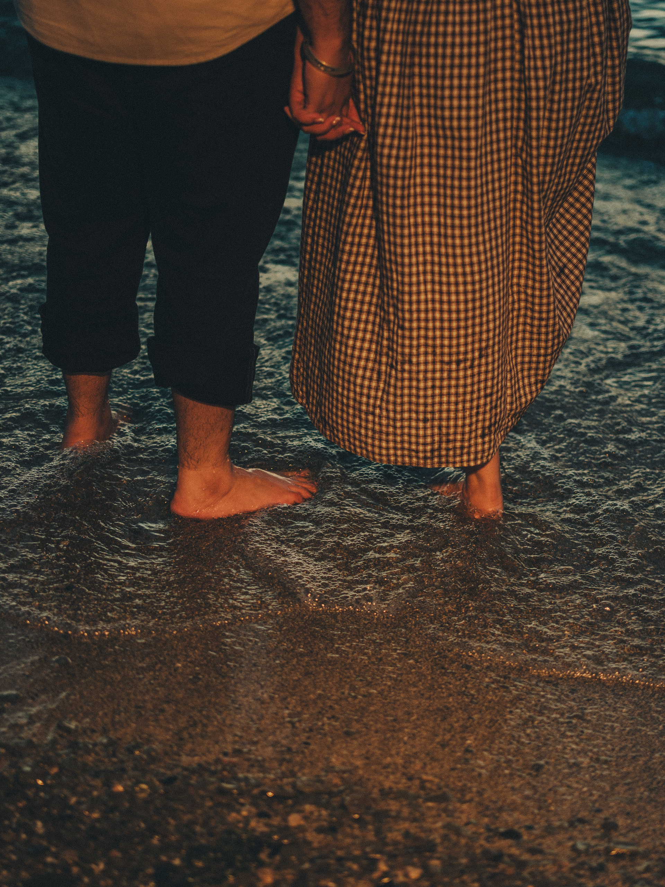

It is 7:06 on a Saturday morning at the end of September. Maninder and Parneet are barefoot at the edge of Lake Ontario, hand in hand, and she has just kicked a splash up around her ankles. He is laughing. Behind them a wooded point runs out into the water, and the horizon has gone pale gold. Sunrise is still a few minutes away.

That frame is from the first minute of their sunrise session on a quiet Lake Ontario beach. It is also the reason I keep asking couples to set an alarm they will not enjoy. For sunrise engagement photos in Toronto, my first choice is the lake. The sun is low and behind you, and for about forty minutes the beach belongs to the two of you. This post is about why that light works and how a sunrise morning actually runs. For where to go, I keep a separate list of [five sunrise spots along Lake Ontario](/blog/best-toronto-sunrise-photo-locations-lake-ontario/).

## What first light does to a photo

At sunrise the sun sits just above the horizon, so the light comes in from the side and from behind, not from above.

Skin goes warm and even. Nobody squints, because the sun is behind them or off to one side, never straight in their eyes. Water and wet sand bounce light back up, so faces stay open even with the sun behind them.

Put the sun behind a couple and it draws a thin line of light around their hair and along the edge of a dress. Water and wet sand throw sparkle, and out of focus that sparkle turns into soft circles of light, like the ones under their hands in the frame below. A thin haze often sits over the lake at that hour and softens the far shore. Shadows run long across the sand instead of pooling under your feet.

The colour moves fast. It is pink or pale gold before the sun is up and gold once it clears the water, and by about forty minutes in it is turning into plain white daylight. Every ten minutes is a different photo. And the beach is empty, or close to it.

## The best time of day is a forty minute window

The light I want starts just before sunrise and runs to about forty minutes after it. Sunrise in Toronto moves a long way through the year. These times are approximate, for the middle of the month unless noted:

- **March:** about 7:30
- **April:** about 6:35
- **May:** about 5:55
- **Late June:** about 5:35
- **July:** about 5:50
- **August:** about 6:20
- **September:** about 6:55
- **Start of October:** about 7:15
- **Mid October:** about 7:30
- **November:** about 7:10
- **Late December:** about 7:50

September and October are the kind months. Sunrise lands around seven, and the sun sits lower all morning. June is the hard one. A 5:35 sunrise means we are on the sand at quarter past five.

Whatever the month, arrive twenty minutes before sunrise, dressed and ready. The first colour comes before the sun is up, and it is the easiest part to miss.

## How Maninder and Parneet's sunrise session ran

We started at the waterline with the wooded point behind them. They walked it barefoot, his trousers rolled, her brown gingham dress swinging just clear of the water. The sun came up behind a low bank of cloud, and for a while only the top edge of that cloud glowed orange. By 7:21 the sun was clear of it.

Then I slowed the shutter to about a fifth of a second. At that speed the two of them stop being sharp and turn into colour and movement in the shallows, his shirt and her dress smeared across the surf, their hands still joined in the middle.

A couple of minutes later they stood with their foreheads together and the sun broke through the gap between their faces. At 7:30 their hands went up against the sun. At 7:33 they were laughing under the big tree that hangs over the shore. At 7:51 Parneet ran ahead of him along the water's edge and looked back over her shoulder, and that one is in black and white.

## We shot the lake twice

That morning was our second time at the lake. On the evening of September 12, after their Parkwood session earlier that day, we spent half an hour on a Lake Ontario beach under flat grey cloud. Same gingham dress, same linen shirt. The frames from that evening are muted and moody, most of them made with a slow shutter, hair and fabric blurring against the grey.

Two Saturdays later we were back on the sand at seven in the morning, and it looked like a different country. Only the light had changed.

## What a sunrise shoot asks of you

**An alarm.** Say sunrise is at 7:09, as it was for us. I would meet you at 6:45. Count back from there for the drive, and for hair and makeup if you are having them done.

**Clothes that can get wet.** Dress for water up to the knee and wind off the lake. Parneet wore a brown gingham midi dress with puff sleeves. Maninder wore a cream linen shirt and black trousers, rolled. Both went barefoot. Light fabric moves, and a slow shutter loves anything that moves. My [guide to what to wear for a pre-wedding shoot](/blog/what-to-wear-pre-wedding-shoot/) covers the rest.

**A warm layer for the car.** You will want it before and after.

**A permit check.** Some parks need a photo permit and most do not. My [park permit guide](/blog/toronto-park-photo-permit-how-to-book/) covers how Toronto's work.

**Coffee after, not before.** The window is short.

**A free day.** In September you are done by about eight, which is why sunrise pairs well with a second location later on. Maninder and Parneet split theirs across two Saturdays instead. Their other location was [Parkwood Estate in Oshawa](/blog/parkwood-estate-engagement-photos-oshawa/), shot at midday two weeks before the sunrise. Both are in [their gallery](/portfolio/maninder-parneet/).

## Who sunrise suits

Sunrise suits couples who want quiet. Water, soft colour, movement, and nobody else on the beach. It suits people who do not mind wet feet at seven in the morning.

It does not suit anyone who is not a morning person. Golden hour in the evening is the same low light in reverse, gold first and pink last, with more people around. If the alarm is the dealbreaker, we shoot the evening instead.

## Watch the film

I filmed both days too. The film shows that light moving. Their pre-wedding film covers Parkwood Estate and the sunrise beach.

  <iframe src="https://www.youtube-nocookie.com/embed/nSe1fLFrNdk" title="Maninder and Parneet, a pre-wedding film at Parkwood Estate and a Lake Ontario sunrise" style="position:absolute;top:0;left:0;width:100%;height:100%;border:0;" allow="accelerometer; autoplay; clipboard-write; encrypted-media; gyroscope; picture-in-picture" allowfullscreen loading="lazy"></iframe>

If sunrise sounds like the two of you, [send me your date](/contact/#inquiry) and roughly where you would like to be. I will check the sunrise time and plan the morning around it. Pre-wedding sessions start at $351.25, and the [pre-wedding page](/services/pre-wedding/) lays out the photo and film options. You can also [build your own package](/pricing/).
