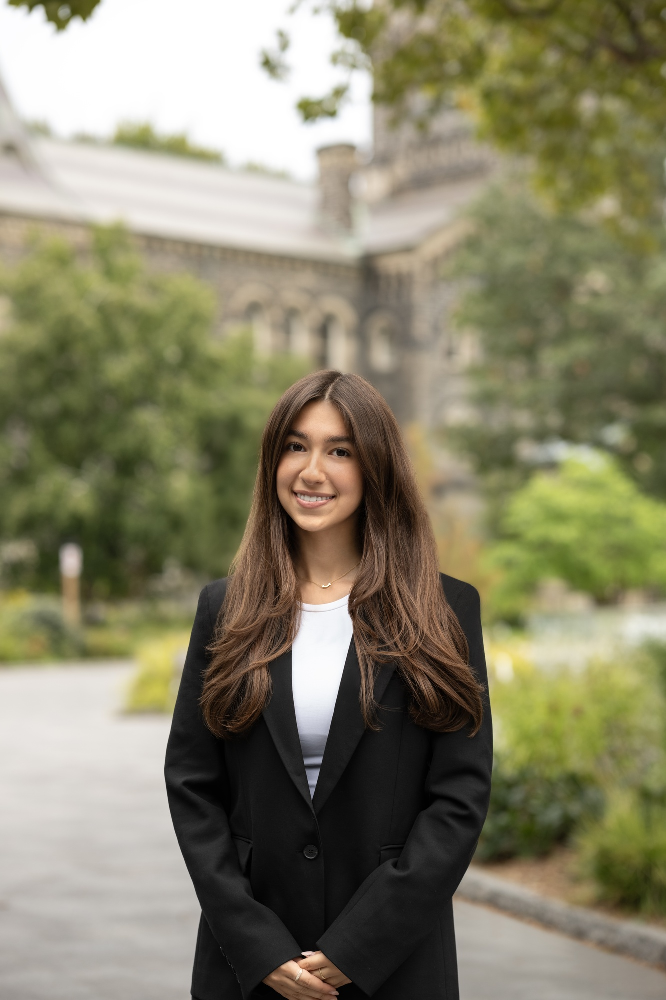

This session with a student used two spots on the St. George campus. At Convocation Hall she stood under the tall stone columns of the portico, with a wooden double door and warm buff stone out of focus behind her. The sky was white and overcast, and the portico roof kept that light from falling straight down on her face.

Outside University College she stood on a path, with grey stone and green trees blurred behind her. She wore the same outfit in both, and the background alone makes them two different photos. That is the case for shooting University of Toronto headshots on the St. George campus.

## Why the St. George campus works for headshots

The St. George campus is downtown, centred on King's College Circle. Its buildings sit close together, so a second background is a short walk away.

Convocation Hall is the round, domed hall with the columned portico out front. Darling and Pearson designed it after the amphitheatre of the Sorbonne in Paris. The cornerstone was laid in June 1904, and the hall opened in June 1907. It is where U of T holds its convocation ceremonies. In spring 2026 that meant 36 ceremonies from June 1 to 18, and more than 15,000 graduates crossed its stage.

For a headshot, the portico is what matters. Its roof blocks the overhead light that puts shadows under the eyes, so your face gets even light from the open front. The columns add tall lines, and the buff stone stays warm and quiet.

University College is older. Cumberland and Storm designed it, and the first students arrived in October 1859. The college calls its style Romanesque Revival, which shows in the round arched windows and the central tower, and it became a National Historic Site of Canada in 1968, one of only two on campus. A fire in 1890 destroyed the east half and the library, and the college was rebuilt by 1892 with its outer walls largely intact.

For a headshot, University College is the cooler, greener option. The stone and trees fall away into texture, which suits a taller, more relaxed frame.

Other spots work too. The Knox College cloister is a covered stone arcade that keeps light even, and Hart House has stone passages. The open lawn of King's College Circle gives you room for a full length frame. I also photograph couples here, and my [University of Toronto engagement photos](/blog/university-of-toronto-engagement-photos/) guide covers these spots.

The cover photo is the LinkedIn frame. The background stays calm, so her face still carries the photo at thumbnail size.

The taller frame suits a bio page or a grad photo. Clasped hands read softer than crossed arms.

## University of Toronto headshots at a glance

- **Where this session happened:** the portico of Convocation Hall and a path outside University College, St. George campus, downtown Toronto.
- **Getting there:** St. George, Museum or Queen's Park subway. Parking is around $10 on a weekend, and weekends are calmer than weekdays during term.
- **Permit:** not needed for a short handheld headshot session. Only wedding day photography needs one, booked through U of T Campus Events.
- **The Student, $151.25:** 30 minutes, 1 location, 1 outfit plus a backup, 2 fully retouched headshots, LinkedIn ready crops and a private online gallery of every good frame, 15 or more. Valid student ID required.
- **The Professional, $301.25:** up to 1 hour on location, 2 to 3 outfit changes, 5 fully retouched headshots, a full gallery of every good frame lightly edited, 30 or more, and LinkedIn, website and print crops.
- **Delivery:** the gallery within a few days, retouched files within 1 week.
- **Add ons:** express 48 hour delivery for $51.25 on either session. Extra retouched images are listed on the packages page.
- **Where to book:** the [headshot packages](/services/headshots/) page, with GTA travel and a free consultation call included.
- **Campus quick reference:** the [U of T location guide](/location-guide/uoft/).

## If you are a student at U of T

These are the places a headshot gets used during a U of T degree.

- **LinkedIn.** If you fix one photo this year, make it the one at the top of your profile.
- **The September career fair.** Book a few weeks before Career Exploration and Education's fair, since retouched files take a week.
- **Internship and work term applications.** Get the photo done before the first application goes out.
- **Grad school and professional school applications.** If a program asks for a photo, have a good one ready.
- **A company bio for your first job.** You can send a photo the same day they ask.
- **Convocation.** A grad photo under the columns of the hall where you will cross the stage. Fall convocation is in late October.

If you are applying to residency through CaRMS, you upload a photo to your CaRMS account as a JPEG under 2 MB. CaRMS describes it as an identification photo for interviews, not something programs grade, and programs only see it shortly before interviews. It does recommend a professional headshot when feasible. So do it properly, but do not lose sleep over it.

**Free headshot events.** U of T does not run a standing free headshot booth. It runs occasional one off headshot events, usually tied to the September career fair. In 2026 that was a sponsored Professional Headshot event on September 17 at the Experiential Learning Commons, 255 Beverley Street, with sign up through Folio. The students' union also ran a free event for professional faculties in March 2023. If a free event lines up with your timing, take it. The Student gives you thirty minutes with me at a spot chosen for the light, and two fully retouched headshots.

If you study elsewhere, my post on [student headshots in Toronto](/blog/student-headshots-toronto/) covers campuses across the GTA.

## What it costs

Both packages are on location, and I direct you the whole time. My price on campus is the same as anywhere else in the GTA, because travel is included.

**The Student, $151.25.** A 30 minute session at one location in one outfit, with a backup in your bag. You get 2 fully retouched headshots and LinkedIn ready crops, plus a private online gallery of every good frame, 15 or more. It covers current students and grads within a year of graduating, with a valid student ID shown when you book. One location means one meeting point, so two buildings a short walk apart on the same campus, like the two in this post, fit inside it.

**The Professional, $301.25.** Up to 1 hour on location, 2 to 3 outfit changes and 5 fully retouched headshots. You also get every good frame, lightly edited, 30 or more, plus LinkedIn, website and print crops, all in a private online gallery.

**Add ons.** Express 48 hour delivery is $51.25 on either session. Extra retouched images are an add on too, priced on the packages page.

Both deliver in 1 week, with the gallery up within a few days so you can pick favourites. The consultation call is free, and I send a short what to wear guide after you book. Details are on the [headshot packages page](/services/headshots/), and my post on [whether professional headshots are worth it](/blog/are-professional-headshots-worth-it/) covers when a phone photo will do.

## Frequently asked questions

**How much do University of Toronto headshots cost?**

The Student session is $151.25. That covers a 30 minute session at one location in one outfit, with a backup in your bag. You get two fully retouched headshots and LinkedIn ready crops, plus a private online gallery of every good frame, 15 or more, delivered in one week. The student rate covers current students and grads within a year of graduating, and I need to see a valid student ID when you book. If you want more time, The Professional session is $301.25 for up to an hour with two to three outfit changes and five fully retouched headshots.

**Do I need a permit for headshots on the St. George campus?**

No. A short handheld session like a headshot does not need a permit on the St. George campus. The university requires a permit only for wedding day photography, which is booked through U of T Campus Events. So for a LinkedIn photo or a grad photo, the only thing to book is the session itself.

**Where on campus do you shoot headshots?**

The session in this post used the portico of Convocation Hall, where the roof stops light from falling straight down on your face, and a path outside University College, where the grey stone and green trees blur behind you. The Knox College cloister is a covered stone arcade that keeps the light even, so it works well too. Hart House has stone passages, and the open lawn of King's College Circle gives you room for a full length frame. On the consultation call I will suggest the spot that suits what the photo is for.

**Does U of T offer free headshots?**

Not as a standing service. U of T runs occasional one off headshot events, usually tied to the September career fair run by Career Exploration and Education. In 2026 that was a sponsored Professional Headshot event on September 17 at the Experiential Learning Commons, 255 Beverley Street, with sign up through Folio. The students' union has also run a free event for professional faculties, in March 2023. If a free event lines up with your timing, take it. The Student gives you thirty minutes with me at a spot chosen for the light, and two fully retouched headshots.

**Can I use my headshots for CaRMS or a grad school application?**

Yes. CaRMS applicants upload a photo to their CaRMS account as a JPEG under 2 MB. CaRMS describes it as an identification photo for interviews, not something programs grade, and programs only see it shortly before interviews. CaRMS recommends a professional headshot when feasible. For grad school and professional school applications, check what each program asks for before you upload.

**What should I wear for my U of T headshots?**

Solid colours photograph best, and busy patterns or large logos compete with your face. Pack a second option in your bag. A blazer or cardigan makes the photo read more formal. Try it on in a mirror from the chest up, because the shoulders are most of what a headshot crop keeps. I send a short what to wear guide after you book.

My longer [what to wear guide](/blog/what-to-wear-pre-wedding-shoot/) is written for couples, but its points on busy patterns and bright colours apply to a headshot too.

## Book a headshot session at U of T

If convocation or a work term application is coming up, sort the photo out early.

[**See the headshot packages →**](/services/headshots/)

Or [send me a note](/contact/?service=headshots) with the date you need the photo by, and I will suggest a spot on campus that suits it.
