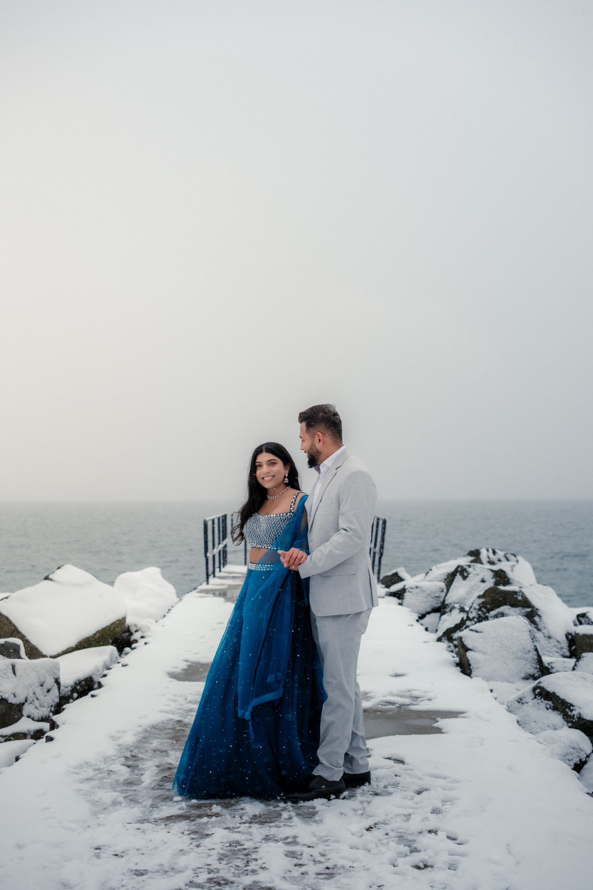
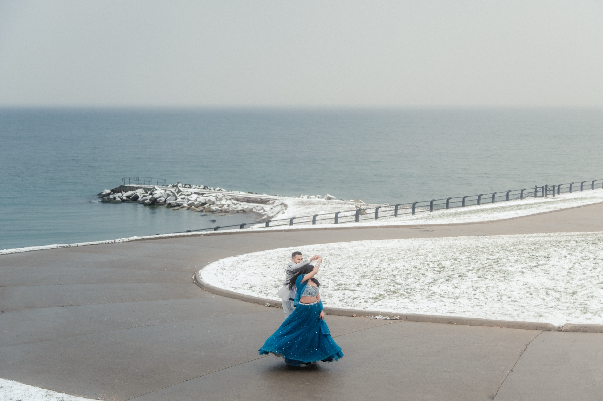
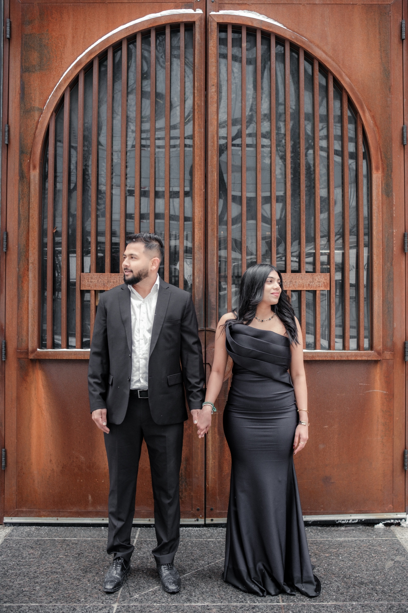
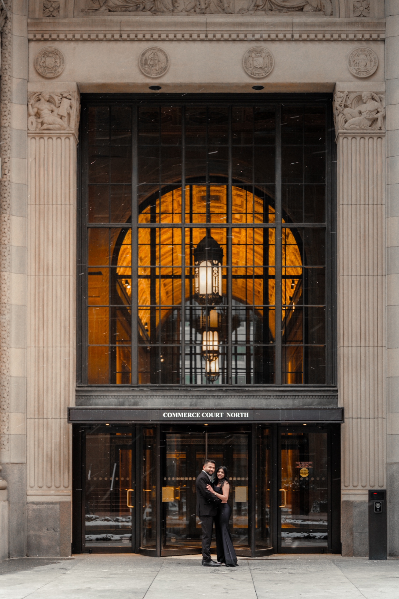
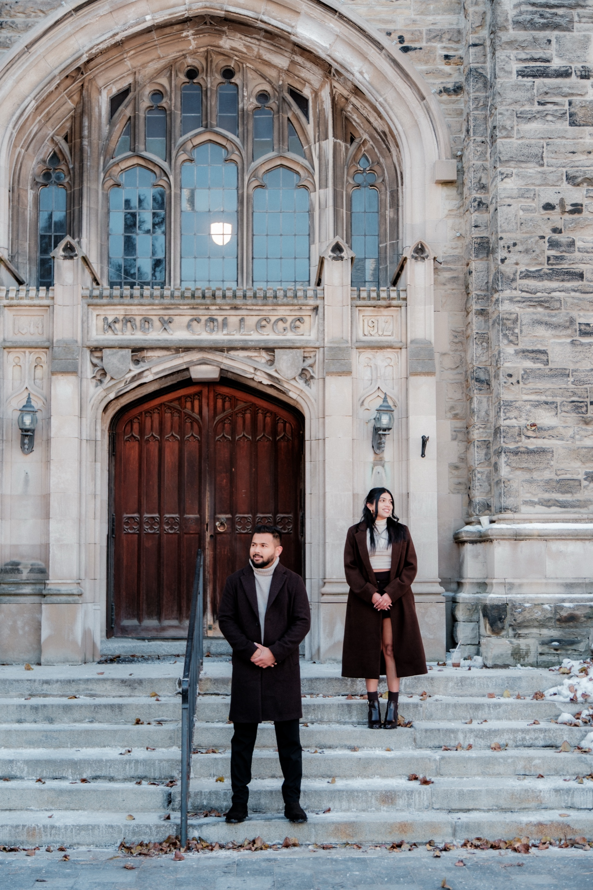
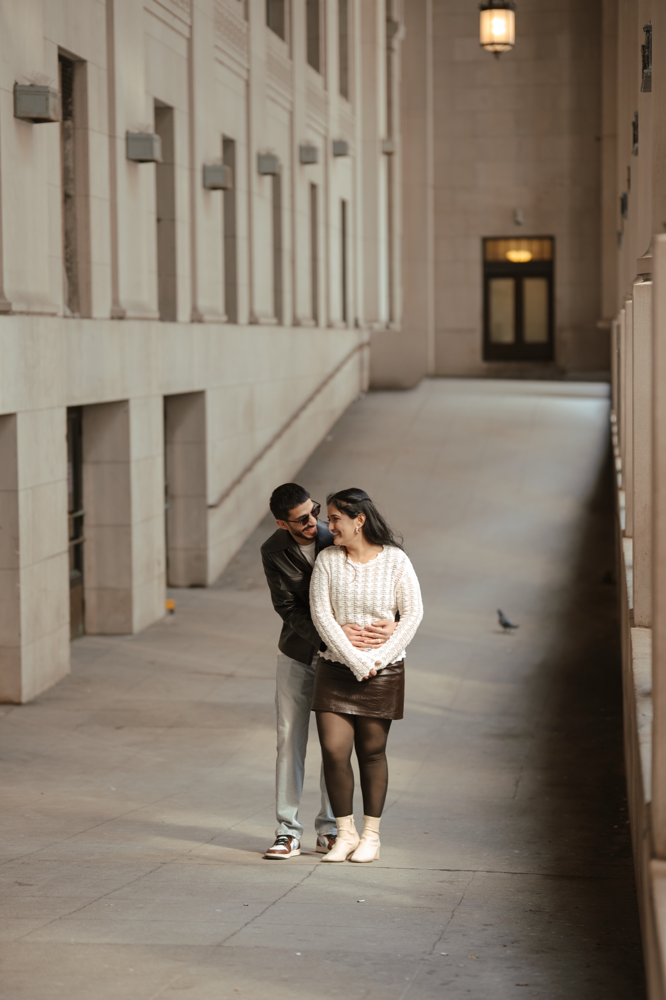

Most people avoid January in Toronto. The wind comes straight off the lake, the light is gone before five, and every sensible person is indoors. That is exactly why I love shooting engagements in it.

On January 4, 2026, I photographed a couple who wanted the real Toronto winter, not the soft snow globe version. We started at RC Harris with snow piled on the breakwater, moved to the Financial District in the afternoon, and finished at the University of Toronto as the last light hit the stone. Three completely different looks in one short winter day. The full gallery is here: [the Winter Special session](/portfolio/winter-special/).

This guide is what I have learned from shooting in the cold. Where to go, when the light works, what to wear, and how to stay warm enough to actually enjoy it.

## Winter engagement photos in Toronto at a glance

**Best locations:** RC Harris on the Scarborough lakeshore, the Financial District, the University of Toronto (Knox College), and Union Station.

**Best light:** Late morning to mid afternoon. The sun stays low all day, so it is soft from about 11 AM.

**Sunset:** Before 5 PM in December and early January. Plan the outdoor locations first.

**Permits:** None at RC Harris, U of T or TD Centre. Union Station needs one for professional photography, requested at least two weeks ahead.

**How long outside:** About 20 to 30 minutes at a time, then a warm car or a lobby between locations.

**Cost:** The same as any season. Sessions start at $351.25. Two or three locations fit the Love Story Duo at $551.25.

## Why winter works in Toronto

Summer engagement photos in Toronto all start to look the same: green trees, warm haze, and a crowd behind you at every popular spot. Winter strips that away.

The lake freezes into steel and white. The parks are empty. And the city's best architecture, the Art Deco waterworks, the bank towers, the Gothic college stone, looks better without leaves in the way. The low winter sun also never gets harsh, so you get soft, flattering light for hours instead of a short golden window at the end of the day.

The catch is the clock and the cold. Both are easy to plan around.

## Where I shoot winter engagements in Toronto

### 1. RC Harris, for snow and the frozen lake

RC Harris is my first stop in winter. The yellow brick and limestone of the water treatment plant sits right on Lake Ontario, and after a snowfall the breakwater rocks and lakeside path turn white. On the January session, she wore a teal lehenga with silver work and he wore a pale grey suit. Against the snow, the colour carried every frame.

No permit is needed for photography here. The street parking nearby is free until 4 PM, which lines up well with a winter schedule. The full guide to the site is in my [RC Harris engagement photos guide](/blog/rc-harris-engagement-photos-toronto/).

### 2. The Financial District, for glass, granite and wet pavement

For the second look, the couple changed into black on black and we drove downtown. Winter is the best season for the Financial District. The pavement is often wet, so the towers reflect off the ground, and the early dark means the lobbies and arches glow by mid afternoon.

We worked King Street West, the granite steps between the towers, and the golden arch of Commerce Court North, all from public sidewalks. TD Centre needs no permit for photography. A streetcar passing behind you is one of the most Toronto frames you can get, and in winter the streets are quiet enough to wait for one.

### 3. The University of Toronto, for stone arches and warm light

I end winter sessions at the University of Toronto when I can. Knox College has Gothic arches, iron lanterns and heavy wooden doors, and in the last hour of winter light the stone turns warm. On January 4 the couple changed again, into long coats and matching knits, and the mood went from city edge to old world quiet.

No permit is needed for engagement or pre-wedding photos at U of T, including the Knox College cloister. Weekend parking on campus is about $10. More on the campus in my [University of Toronto engagement photos guide](/blog/university-of-toronto-engagement-photos/).

### 4. Union Station, for a covered option

In March I photographed Vanika and Mayank at Union Station and RC Harris, and her red tulle gown against the limestone was one of my favourite colour pairings of the year. Union Station gives you a grand covered space for the coldest days. It is City of Toronto property, and professional photography there needs a permit requested by email at least two weeks ahead, so book it early. See [Vanika and Mayank's gallery](/portfolio/vanika-mayank/).

Every permit rule I know for these places and dozens more is in my [Toronto photo permits table](/toronto-photo-permits/).

## When to shoot: the winter clock

**Start late morning.** By 11 AM the light is soft and the cold has eased a little. I put the most exposed location, usually the lake, first.

**Move fast between locations.** In winter I plan two or three spots that are a short drive apart, so you warm up in the car between them.

**Finish before 5 PM.** In December and early January the sun is down before five. The last half hour of light is beautiful, so I save the location with the warmest stone or a lit doorway for it.

**Snow is a bonus, not a requirement.** Fresh snow is gorgeous, but a grey, cold day still gives you the lake, the stone and the empty streets. I watch the forecast with you and we choose the best day in your window.

## What to wear for winter engagement photos

**Coats are part of the look.** A long wool coat, a houndstooth or plaid layer, a good scarf. On the January session, the coats and knits made the U of T frames.

**Plan for an outfit change.** Two looks in one winter day is easy, because you change in the car between locations. Something bright for the snow, something dark or tailored for the city.

**Colour against snow.** Teal, red, emerald and rich jewel tones stand out against white and grey. Pale outfits can disappear into snow.

**Two pairs of shoes.** Warm boots for walking, then dressier shoes for the close portraits.

**Gloves you can slip off.** Ring and hand frames need bare hands for about thirty seconds. Keep the gloves in a pocket.

For the full outfit guide, read [what to wear for a pre-wedding shoot](/blog/what-to-wear-pre-wedding-shoot/).

## How to stay warm (and still enjoy it)

1. **Shoot in short bursts.** Twenty to thirty minutes outside, then a few minutes in the car or a lobby.
2. **Keep coats on until the frame.** You take the coat off for a handful of shots, then it goes straight back on. I tell you when.
3. **Bring hand warmers.** Tuck them in pockets and boots.
4. **Have a hot drink in the car.** It helps more than you would think.
5. **Dress warm under the outfit.** Thermal layers under a suit or a lehenga are invisible in photos.

Cold couples do not look stiff in photos if they are moving. I keep you walking, spinning and laughing, which keeps you warm and gives the most natural frames.

## What winter engagement photos cost

The same as any other season. My pre-wedding sessions start at $351.25 for the Love Story Mini, up to 2 hours at one location. A winter day with two or three locations, like the January session above, fits the Love Story Duo at $551.25 for up to 3 hours, or a longer session if you want more looks. Every package is listed on my [pre-wedding page](/services/pre-wedding/).

## Book a winter session

Winter dates are easier to get than summer ones, and the locations are empty. If you want your engagement photos to look like Toronto in its most dramatic season, tell me your dates and I will help you pick the best day for the light and the snow.

[**See pre-wedding packages →**](/services/pre-wedding/)
